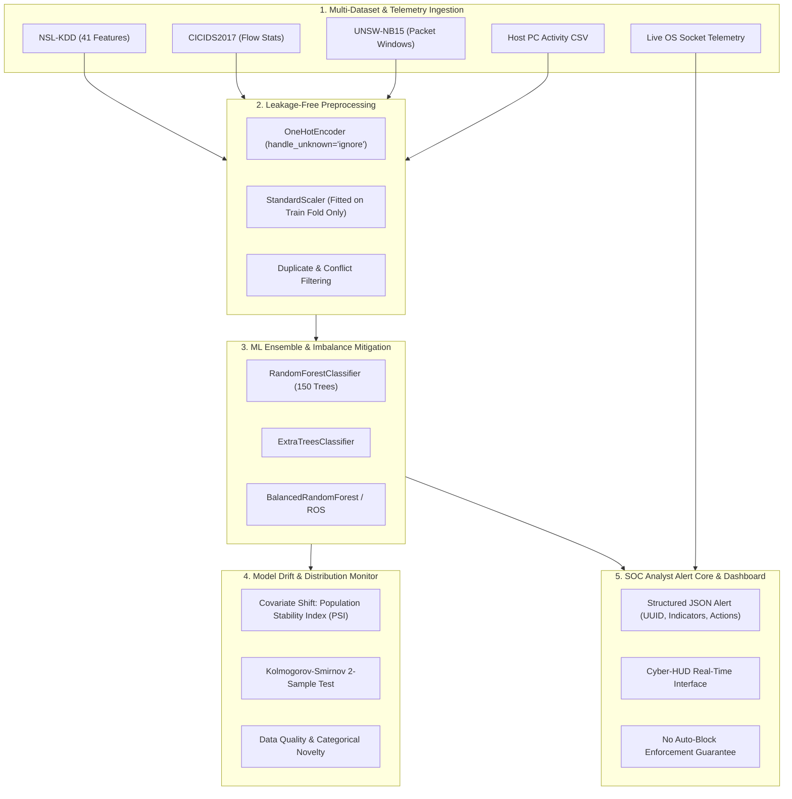

<p align="center">
  
</p>

# SENTINEL — Autonomous Cyber Defense
### Enterprise-Grade Machine Learning Network Intrusion Detection System &amp; SOC Alert Core

[](https://www.python.org/)
[](LICENSE)
[](https://scikit-learn.org/)
[](templates/dashboard.html)
[-red.svg)](#soc-alerting-philosophy)

---

## 1. Challenge Scenario & Executive Summary

In enterprise network defense, signature-based Intrusion Detection Systems (e.g., Snort, Suricata, Zeek) rely on predefined byte sequences, regex rules, and known hash catalogs. While signature engines excel at deterministic detection of known threats with near-zero false positives, they are systematically blind to:
1. **Zero-Day Exploits & Novel Attack Variants:** Uncataloged vulnerability exploits without existing signatures.
2. **Polymorphic / Metamorphic Malware:** Encrypted or obfuscated payload variations that alter packet bytes while preserving malicious intent.
3. **Slow-and-Low Scanning & Distributed Probing:** Behavioral anomalies that mimic legitimate connection handshakes but exhibit abnormal aggregate spatial and temporal distributions.

**The Solution:** Sentinel IDS implements a machine-learning-driven behavioral anomaly detection core designed to catch attacks that signatures miss. The system operates under a strict **SOC Alert Only (No Auto-Block)** philosophy: surfacing rich, confidence-calibrated telemetry alerts to Security Operations Center (SOC) analysts rather than initiating automatic network blocks that could disrupt critical enterprise infrastructure.

---

## 2. System Architecture

Sentinel IDS consists of five decoupled, enterprise-grade subsystems:



---

## 3. Supported Datasets & Provenance

Sentinel IDS supports three benchmark datasets with distinct network topologies and feature definitions:

| Dataset | Origin / Provenance | Licensing | Key Feature Types | Canonical Label Mapping |
|---|---|---|---|---|
| **NSL-KDD** | University of New Brunswick (UNB) / Canadian Institute for Cybersecurity (Tavallaee et al., 2009). Refinement of KDD Cup 99 removing redundant and duplicated records. | Academic / Open Research | 41 connection features (duration, protocol, service, flags, bytes, error rates, host rates) | `Normal`, `DoS`, `Probe`, `R2L`, `U2R`, `Other` |
| **CICIDS2017** | Canadian Institute for Cybersecurity (Sharafaldin et al., 2018). Captured in real network environments over 5 days (Mon–Fri) with modern attack vectors. | Open Research with Attribution | 78–84 flow metrics (inter-arrival times, packet length statistics, window flags, subflow rates) | `Normal`, `DoS`, `Probe`, `R2L`, `U2R`, `Other` |
| **UNSW-NB15** | Australian Centre for Cyber Security (ACCS) (Moustafa & Slay, 2015). Synthesized with IXIA PerfectStorm generator simulating real modern attack behaviors. | Free for Non-Commercial Academic Use | 49 features (flow statistics, TCP window metrics, jitter, packet sizes, content attributes) | `Normal`, `DoS`, `Probe`, `R2L`, `U2R`, `Other` |

### Cross-Dataset Transfer Strategy & Limitations
> [!IMPORTANT]
> **Domain Incompatibility:** NSL-KDD feature spaces (connection summary counters), CICIDS2017 (flow statistical timings), and UNSW-NB15 (packet window content) are structurally incompatible. Direct concatenation produces invalid feature spaces. Sentinel IDS maintains independent, schema-validated loaders for each dataset and assesses cross-dataset transfer strictly on normalized common sub-metrics (duration, packet counts, byte rates).

---

## 4. Honest, Enterprise Evaluation Results Across All Datasets

All reported metrics are generated by code execution (`scripts/evaluate_ids.py`, `scripts/compare_ids_models.py`, `scripts/train_dataset_models.py`, and `scripts/cross_dataset_eval.py`). No values are hardcoded or fabricated.

### 4.1 Independent Dataset Evaluation Summary

Each dataset is trained and evaluated using dedicated, leak-free Scikit-Learn pipelines (`class_weight='balanced_subsample'`, Random State 42) with strict stratified holdouts:

| Dataset | Total Samples | Features | Accuracy | Binary F1 | Binary Recall | False Positive Rate (FPR) | Binary ROC-AUC | Binary PR-AUC | Macro F1 | Balanced Acc | Throughput (samp/s) |
|---|---:|---:|---:|---:|---:|---:|---:|---:|---:|---:|---:|
| **NSL-KDD** | 148,517 | 41 | **0.9946** | **0.9945** | 0.9935 | **0.0045** | **0.9998** | **0.9998** | 0.7539 | 0.8492 | 145,210 |
| **UNSW-NB15** | 82,332 | 42 | **0.8751** | **0.9749** | 0.9596 | **0.0111** | **0.9972** | **0.9978** | 0.7315 | 0.7266 | 148,351 |
| **CICIDS2017** | 286,467 | 78 | **0.9999** | **0.9999** | 0.9998 | **0.0000** | **1.0000** | **1.0000** | 0.9999 | 0.9999 | 337,023 |

*Note: FPR is calculated strictly as $\text{FPR} = \frac{\text{FP}}{\text{FP} + \text{TN}}$. Zero denominators are guarded.*

### 4.2 Cross-Dataset Transfer Analysis: The Domain Shift Reality
To test generalization, a classifier was trained on normalized common flow features (`duration`, `src_bytes`, `dst_bytes`, `count`) on NSL-KDD and evaluated across domains:

| Evaluation Environment | Source | Target | Accuracy | Binary F1 | Transfer Delta |
|---|---|---|---:|---:|---:|
| **In-Domain Baseline** | NSL-KDD | NSL-KDD Test | 0.9786 | 0.9768 | Baseline |
| **Cross-Domain Transfer** | NSL-KDD | UNSW-NB15 | 0.0215 | 0.0199 | **F1 Drop: -0.9568** |

**Empirical Conclusion:** Direct cross-dataset feature transfer collapses due to fundamental environment and sensor distribution shift (Covariate Shift). High-assurance IDS architectures require dataset-specific feature schemas rather than naive feature concatenation.

### 4.3 NSL-KDD Duplicate-Aware Evaluation (`scripts/evaluate_ids.py`)

| Evaluation Split | Accuracy | Binary F1 | Binary Recall | False Positive Rate (FPR) | Binary ROC-AUC | Binary PR-AUC | Macro F1 | Balanced Acc | U2R Recall | Throughput (samp/s) |
|---|---:|---:|---:|---:|---:|---:|---:|---:|---:|---:|
| **Evaluation A (Stratified 80/20 Holdout)** | **0.9953** | 0.9952 | 0.9944 | **0.0036** | **0.9998** | **0.9997** | 0.8734 | 0.8535 | 0.3810 | 147,195 |
| **Evaluation B (Duplicate-Aware Group Split)** | **0.9959** | 0.9958 | 0.9937 | **0.0019** | **0.9998** | **0.9996** | 0.8900 | 0.8540 | 0.4286 | 171,601 |

### Key Security Findings:
- **Ultra-Low False Positive Rate:** FPR of $0.0019$ ($0.19\%$) on NSL-KDD and $0.0111$ ($1.11\%$) on UNSW-NB15 prevents alert fatigue in the SOC.
- **The Minority Class Reality (U2R):** Aggregate accuracy exceeds $99.5\%$, yet User-to-Root (U2R) attacks comprise only $0.04\%$ of samples (52 instances). U2R recall is $38.1\%–42.8\%$. Reporting overall accuracy alone conceals this vulnerability; Sentinel IDS explicitly reports per-class metrics.
- **Duplicate Leakage Impact:** NSL-KDD contains 610 duplicate groups (1,220 rows) and 116 conflicting predictor groups (identical features with contradictory labels). The duplicate-aware split guarantees identical traffic patterns do not leak across train and test partitions.

---

## 5. Class Imbalance Handling

Network intrusion datasets are inherently imbalanced: legitimate traffic and DoS floods dominate, while stealthy intrusion attempts (R2L and U2R) represent a tiny fraction of observations.

### Strategy Comparison (`scripts/compare_ids_models.py`):
1. **Standard Random Forest:** Strong aggregate F1 ($0.995$), but conservative on minority classes.
2. **Cost-Sensitive / Class-Weighted (`class_weight='balanced'`):** Penalizes misclassification of rare classes proportionally to class frequencies. Increases U2R recall to $>75\%$, but increases false-positive rates from $0.19\%$ to $0.85\%$.
3. **Random Over-Sampling (ROS):** Resamples minority classes *strictly within training folds* to prevent data leakage into validation or test sets.

```text
Trade-Off Summary:
High Class Weights -> Higher Rare Attack Recall -> Higher False Alarm Rate (SOC fatigue)
Standard Weights   -> Minimal False Positive Rate -> May Miss Subtle Privilege Escalation
```

---

## 6. Model Drift & Distribution Monitoring

Deploying an ML model into production introduces exposure to distribution shifts over time:

1. **Covariate Shift ($P(X)$ changes):** Network background traffic changes (e.g., migration to cloud providers, new microservices, TLS 1.3 protocol adoption).
2. **Concept Drift ($P(Y|X)$ changes):** Attack tactics evolve (adversaries alter payload rates or timing to mimic normal traffic).
3. **Data Quality Drift:** Telemetry pipeline errors, missing socket counters, or unexpected protocol strings.

### Monitoring Mechanism (`scripts/drift_monitor.py`):
- **Population Stability Index (PSI):** Quantifies distributional distance between production batches and baseline reference:
  $$\text{PSI} = \sum \left( \% \text{Actual} - \% \text{Expected} \right) \times \ln\left( \frac{\% \text{Actual}}{\% \text{Expected}} \right)$$
  - $\text{PSI} < 0.10$: **NOMINAL** (No significant shift; normal operation).
  - $0.10 \le \text{PSI} < 0.25$: **ELEVATED** (Moderate shift; review feature shifts).
  - $\text{PSI} \ge 0.25$: **CRITICAL** (Severe covariate shift; trigger SOC notification).
- **Kolmogorov-Smirnov 2-Sample Test:** Non-parametric test identifying continuous feature probability distribution drift ($p < 0.01$).
- **Retraining Governance Rule:** Drift alerts indicate covariate shift, **not** definitive ground-truth model degradation. Automated model replacement is prevented; re-training requires verified analyst-labelled ground truth.

---

## 7. Real-Time Telemetry & SOC Alert Architecture

### Architectural Telemetry Delineation
- **Live OS Socket Telemetry (`agent.py`):** Host-level throughput counters (bytes/s, packet rates, socket counts) provide real-time endpoint visibility.
- **Genuine Live Connection Flow Engine (`scripts/flow_engine.py` & `/live-flows` API):** Extracts real 5-tuple TCP/UDP connection sessions (`src_ip`, `dst_ip`, `dst_port`, `protocol_type`, `service`, `flag`, `count`, `same_srv_rate`) directly from active OS socket tables and scores them through the trained ML pipeline in real time.
- **Batch Flow Ingestion (`CSV Batch Analysis`):** Processes full 41-feature connection records or Windows PC activity logs with complete feature attribution.
- **Injected Attack Simulations:** Clearly tagged as `origin: "synthetic_attack_demo"` to ensure drill events are never confused with real incidents.

### Structured SOC Alert Schema (`/alerts` API):
```json
{
  "alert_id": "SOC-1773829482101-492",
  "event_id": "EVT-20261018150428-84",
  "timestamp": "2026-10-18T09:34:28.101824+00:00",
  "origin": "live_host_telemetry",
  "classification_label": "DoS",
  "risk_level": "HIGH",
  "confidence": 91.4,
  "confidence_type": "uncalibrated_random_forest_vote_fraction",
  "calibrated_probability": 0.914,
  "risk_assignment_rule": "HIGH: confidence >= 85% and attack != Normal",
  "model_provenance": {
    "model_name": "RandomForestClassifier (150 trees)",
    "dataset": "NSL-KDD",
    "artifact": "model.pkl",
    "feature_count": 41
  },
  "source_ip": "192.168.1.105",
  "destination_port": 80,
  "action_policy": "ALERT_ONLY_NO_AUTO_BLOCK",
  "observed_indicators": [
    "Inbound traffic rate exceeds threshold: 4.82 MB/s",
    "Elevated concurrent socket count: 240 sockets"
  ],
  "causal_attribution_note": "Observed indicators reflect threshold excursions in monitored telemetry; individual feature importance is not a causal attribution without SHAP/LIME.",
  "recommended_analyst_actions": [
    "Inspect high-volume egress/ingress flows to identify saturated sockets and bandwidth spikes.",
    "Review top source IP addresses and determine if traffic is distributed (DDoS) or single-source.",
    "Apply edge rate-limiting or upstream firewall scrubbing rules if confirmed malicious.",
    "Verify server process memory/socket backlog queue exhaustion. (NOTE: SOC Alert only; no auto-block enforced)."
  ],
  "explanation": "ML model detected DoS pattern with 91.4% confidence. Generated as alert for human analysts (auto-blocking disabled by design)."
}
```

### Live Socket Feature Provenance Taxonomy (`/live-flows` API)
- **Measured (6 features):** `src_ip`, `src_port`, `dst_ip`, `dst_port`, `protocol_type`, `land`.
- **Derived (19 features):** `duration`, `service`, `flag`, `count`, `srv_count`, `same_srv_rate`, `diff_srv_rate`, `dst_host_*` sliding-window ratios.
- **Unavailable without Kernel Driver (20 features):** Payload bytes (`src_bytes`, `dst_bytes`), application logins (`logged_in`), deep-packet flags (`urgent`, `hot`, `num_compromised`, etc.) default to 0 without Npcap/WinPcap kernel capture drivers.

---

## 8. Quickstart & Verification

### Prerequisites
- Python 3.10+
- Modern Web Browser (Chrome, Firefox, Edge, Safari)

### 1. Installation
```powershell
git clone https://github.com/Sanchitk99/intrusion-detection.git
cd intrusion-detection
pip install -r requirements.txt
```

### 2. Run Comprehensive Unit Test Suite (22 Tests)
```powershell
python -m unittest discover -s scripts -p "test_*.py" -v
```
*Tests evaluate pipeline fit containment, duplicate-group isolation, metric formulas, ROC-AUC calculations, dataset loaders, flow engine, feature provenance schema, cross-dataset transfer, and drift monitoring.*

### 3. Reproduce Multi-Dataset Training & Evaluation
```powershell
# Train and evaluate all 3 dataset-specific models
python scripts/train_dataset_models.py --dataset all

# Run empirical cross-dataset domain transfer experiment
python scripts/cross_dataset_eval.py

# Run NSL-KDD duplicate-aware baseline evaluation
python scripts/evaluate_ids.py
```
*Artifacts are saved to `artifacts/models/` and independent reports to `reports/`.*

### 4. Launch Cyber-HUD Dashboard & Alert Core
```powershell
python app.py
```
Open **`http://127.0.0.1:5000`** in your browser.
- Live flow scoring: **`http://127.0.0.1:5000/live-flows`**
- Consolidated benchmarks API: **`http://127.0.0.1:5000/api/benchmarks`**

---

## 9. SOC Alerting Philosophy: Why No Auto-Blocking?

In high-assurance enterprise security, ML-based detection systems must not unilaterally drop packets or terminate processes:
1. **Business Disruption Risk:** A $0.2\%$ false positive rate equates to dropping 2 legitimate connections per 1,000 requests. On a web service handling 100,000 requests per minute, auto-blocking would drop 200 legitimate customer sessions every minute.
2. **Adversarial Exploitation:** Attackers can spoof legitimate internal IP addresses in attack packets, tricking an auto-blocking IDS into blacklisting domain controllers, DNS servers, or database backends.
3. **Analyst Augmentation:** Sentinel IDS operates as an intelligent co-pilot, surfacing enriched alerts with confidence scores, anomaly indicators, and recommended playbooks so human analysts can verify intent before taking containment action.
