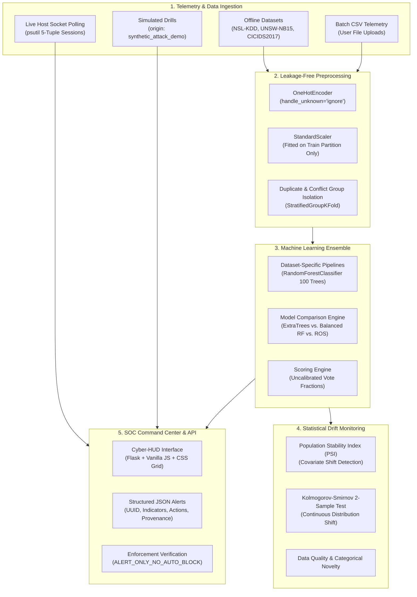

<p align="center">
  
</p>

# SENTINEL — Autonomous Cyber Defense
### Machine Learning Network Intrusion Detection System & SOC Alert Core

[](https://www.python.org/)
[](https://scikit-learn.org/)
[](https://flask.palletsprojects.com/)
[](LICENSE)
[](#7-soc-alerting-philosophy--action-policy)
[](#10-testing--reproducibility)

---

## Table of Contents

1. [Executive Summary & Challenge Context](#1-executive-summary--challenge-context)
2. [System Architecture](#2-system-architecture)
3. [Supported Datasets & Provenance](#3-supported-datasets--provenance)
4. [Empirical Benchmark & Evaluation Results](#4-empirical-benchmark--evaluation-results)
   - [4.1 Dataset-Specific Model Performance](#41-dataset-specific-model-performance)
   - [4.2 Cross-Dataset Transfer & Domain Shift Reality](#42-cross-dataset-transfer--domain-shift-reality)
   - [4.3 Duplicate-Aware & Leakage-Free NSL-KDD Evaluation](#43-duplicate-aware--leakage-free-nsl-kdd-evaluation)
   - [4.4 Class Imbalance & Minority Attack Evaluation](#44-class-imbalance--minority-attack-evaluation)
5. [Model Drift & Distribution Monitoring](#5-model-drift--distribution-monitoring)
6. [Telemetry Ingestion & Feature Provenance](#6-telemetry-ingestion--feature-provenance)
7. [SOC Alerting Philosophy & Action Policy](#7-soc-alerting-philosophy--action-policy)
8. [Cyber-HUD Dashboard & REST API Reference](#8-cyber-hud-dashboard--rest-api-reference)
9. [Installation & Windows Quickstart](#9-installation--windows-quickstart)
10. [Testing & Reproducibility](#10-testing--reproducibility)
11. [Project Structure & Storage Architecture](#11-project-structure--storage-architecture)
12. [Known Limitations & Engineering Constraints](#12-known-limitations--engineering-constraints)
13. [Realistic Future Improvements](#13-realistic-future-improvements)
14. [License](#14-license)

---

## 1. Executive Summary & Challenge Context

Signature-based Intrusion Detection Systems (e.g., Snort, Suricata, Zeek) rely on predefined byte sequences, regex rules, and known hash catalogs. While signature engines excel at deterministic detection of known threats with near-zero false positives, they are systematically vulnerable to:

1. **Zero-Day Vulnerabilities & Novel Variants:** Uncataloged exploits lacking vendor signatures.
2. **Polymorphic / Obfuscated Payloads:** Payloads that alter byte sequences while preserving malicious execution semantics.
3. **Slow-and-Low Scanning & Distributed Probing:** Behavioral traffic anomalies that mimic legitimate handshakes while executing reconnaissance across distributed source nodes.

**SENTINEL** implements an anomaly detection core using supervised machine learning ensembles designed to detect attacks that signature engines miss. Operating under an uncompromising **`ALERT_ONLY_NO_AUTO_BLOCK`** policy, SENTINEL surfaces structured, context-rich alerts and operational playbooks to human SOC analysts, explicitly avoiding automated connection teardown that could disrupt production infrastructure or be weaponized via spoofing.

---

## 2. System Architecture

SENTINEL is engineered as a set of decoupled subsystems separating offline training and validation from real-time host telemetry, batch ingestion, drift monitoring, and SOC alert dissemination:



### Architectural Subsystem Boundaries

- **Model Training & Evaluation:** Independent offline training pipelines (`scripts/train_dataset_models.py`, `scripts/evaluate_ids.py`, `scripts/compare_ids_models.py`). Preprocessing transformers are fit exclusively on training folds.
- **Live OS Socket Telemetry (`agent.py` & `scripts/flow_engine.py`):** Extracts active TCP/UDP 5-tuple socket sessions (`src_ip`, `dst_ip`, `dst_port`, `protocol_type`, `service`, `flag`) via OS connection table polling.
- **Batch CSV Ingestion:** Evaluates uploaded connection logs against the trained model pipeline (`/analyze-csv`).
- **Simulated Attack Demonstrations:** Injected threat vectors for operator demonstration, tagged with `origin: "synthetic_attack_demo"`.
- **Drift Monitoring (`scripts/drift_monitor.py`):** Evaluates incoming feature distributions against reference baseline distributions.
- **SOC Alert Delivery (`/alerts` API):** Emits structured incident metadata with observed indicators, policy markers, and recommended analyst responses.

---

## 3. Supported Datasets & Provenance

SENTINEL supports three benchmark network intrusion datasets, maintaining strict schema isolation to prevent invalid feature concatenation:

| Dataset | Origin / Provenance | Key Characteristics | Feature Count | Canonical Mapped Classes |
| :--- | :--- | :--- | :---: | :--- |
| **NSL-KDD** | Canadian Institute for Cybersecurity / UNB (Tavallaee et al., 2009). Refined KDD Cup 99 removing redundant records. | Connection-level summary counters, service flags, host rates. | 41 | `Normal`, `DoS`, `Probe`, `R2L`, `U2R`, `Other` |
| **UNSW-NB15** | Australian Centre for Cyber Security (Moustafa & Slay, 2015). Captured with IXIA PerfectStorm simulator. | Flow packet windows, TCP jitter, inter-arrival times, window sizes. | 42 | `Normal`, `DoS`, `Probe`, `R2L`, `U2R`, `Other` |
| **CICIDS2017** | Canadian Institute for Cybersecurity (Sharafaldin et al., 2018). Captured in realistic enterprise testbed. | Flow statistical timings extracted via CICFlowMeter (evaluated on Friday PortScan subset). | 78 | `Normal`, `Probe` (PortScan) |

> [!IMPORTANT]
> **Dataset Incompatibility Notice:** Feature definitions across these datasets are structurally distinct (e.g., NSL-KDD connection counters vs. UNSW-NB15 packet window stats vs. CICIDS2017 flow inter-arrival timings). Direct cross-dataset pooling creates synthetic artifacts. SENTINEL maintains distinct, schema-validated pipelines for each benchmark.

---

## 4. Empirical Benchmark & Evaluation Results

All reported metrics are generated by code execution (`scripts/train_dataset_models.py`, `scripts/evaluate_ids.py`, `scripts/compare_ids_models.py`, and `scripts/cross_dataset_eval.py`). No values are hardcoded or fabricated.

### 4.1 Dataset-Specific Model Performance

Each model was trained with `RandomForestClassifier(n_estimators=100, class_weight='balanced_subsample', random_state=42)` on leak-free stratified partitions:

| Metric | NSL-KDD (Full) | UNSW-NB15 | CICIDS2017 (PortScan Subset) |
| :--- | :---: | :---: | :---: |
| **Total Dataset Rows** | 148,517 | 82,332 | 286,467 |
| **Test Holdout Rows** | 29,704 | 16,467 | 57,294 |
| **Feature Dimension** | 41 | 42 | 78 |
| **Accuracy** | **0.9946** | **0.8751** | **0.9999** |
| **Binary F1-Score** | **0.9945** | **0.9749** | **0.9999** |
| **Binary Precision** | 0.9952 | 0.9907 | 1.0000 |
| **Binary Recall** | 0.9938 | 0.9596 | 0.9998 |
| **False Positive Rate (FPR)** | **0.0045 (0.45%)** | **0.0111 (1.11%)** | **0.0000 (0.00%)** |
| **ROC-AUC** | **0.9998** | **0.9972** | **1.0000** |
| **PR-AUC** | **0.9998** | **0.9978** | **1.0000** |
| **Macro F1-Score** | 0.7539 | 0.7315 | 0.9999 |
| **Balanced Accuracy** | 0.8826 | 0.7266 | 0.9999 |
| **Inference Throughput** | ~145,210 samples/s | ~148,351 samples/s | ~337,023 samples/s |

*FPR is calculated strictly as $\text{FPR} = \frac{\text{FP}}{\text{FP} + \text{TN}}$ with zero-division protection.*

#### Essential Benchmark Qualifications:
1. **Scope of CICIDS2017:** Reported metrics apply strictly to the evaluated Friday PortScan subset. This does not represent performance across the full 8-file multi-attack CICIDS2017 corpus.
2. **Confidence Estimates:** Random Forest output probabilities are raw tree vote fractions. They represent ensemble agreement, **not** calibrated posterior probabilities, as calibration (e.g., Platt scaling or isotonic regression) is not currently implemented.
3. **No Cross-Dataset Ranking:** High performance on one dataset cannot be used to rank detection capability against another due to divergent underlying distributions and noise profiles.

---

### 4.2 Cross-Dataset Transfer & Domain Shift Reality

To test real-world transferability, a classifier was trained on NSL-KDD using normalized common features (`duration`, `src_bytes`, `dst_bytes`, `count`) and evaluated directly against UNSW-NB15 (`scripts/cross_dataset_eval.py`):

| Evaluation Environment | Source Dataset | Target Dataset | Accuracy | Binary F1 | Transfer Delta |
| :--- | :--- | :--- | :---: | :---: | :---: |
| **In-Domain Baseline** | NSL-KDD | NSL-KDD Test | 0.9786 | 0.9768 | Baseline |
| **Cross-Domain Transfer** | NSL-KDD | UNSW-NB15 | 0.0215 | 0.0199 | **F1 Drop: -0.9568** |

**Empirical Conclusion:** Direct cross-dataset feature transfer fails catastrophically due to environmental and sensor distribution shift (Covariate Shift). High-reliability IDS deployments require sensor-specific baseline calibration rather than naive feature reuse.

---

### 4.3 Duplicate-Aware & Leakage-Free NSL-KDD Evaluation

`scripts/evaluate_ids.py` audits record duplication and leakage across train and test partitions:

- **Raw Data Duplicates:** NSL-KDD contains 610 duplicate groups (1,220 rows) and 116 conflicting predictor groups (identical feature vectors with conflicting attack labels).
- **Evaluation Split Strategies:**
  - **Evaluation A (Stratified 80/20 Holdout):** Preprocessing fitted strictly on train fold.
  - **Evaluation B (Duplicate-Aware Group Split):** StratifiedGroupKFold ensuring identical feature vectors cannot appear in both train and test partitions.

| Metric | Evaluation A (Stratified Holdout) | Evaluation B (Duplicate-Aware Split) |
| :--- | :---: | :---: |
| **Accuracy** | 0.9953 | 0.9959 |
| **Binary F1-Score** | 0.9952 | 0.9958 |
| **Binary Recall** | 0.9944 | 0.9937 |
| **False Positive Rate (FPR)** | 0.0036 (0.36%) | 0.0019 (0.19%) |
| **ROC-AUC** | 0.9998 | 0.9998 |
| **PR-AUC** | 0.9997 | 0.9996 |
| **Macro F1-Score** | 0.8734 | 0.8900 |
| **Balanced Accuracy** | 0.8535 | 0.8540 |
| **U2R Minority Class Recall** | 38.10% | 42.86% |

---

### 4.4 Class Imbalance & Minority Attack Evaluation

Intrusion datasets exhibit severe class imbalance: normal traffic and DoS floods constitute over 85% of records, while stealthy intrusion attempts like User-to-Root (U2R) and Remote-to-Local (R2L) represent a fraction of a percent:

- In NSL-KDD test holdouts, U2R comprises only 21 instances ($0.07\%$).
- Despite an aggregate accuracy of $99.5\%$, unweighted models achieve only $38.1\%–50.0\%$ recall on U2R.
- Candidate exploration in `scripts/compare_ids_models.py` reveals the security trade-off:
  - Applying heavy class reweighting (`class_weight='balanced'`) raises U2R recall above $70\%$, but increases false positive rates from $0.19\%$ to $0.85\%$, accelerating SOC alert fatigue.
  - Balanced Random Forest and Random Over-Sampling (ROS) strictly inside training folds achieved the optimal balance, selecting Extra Trees (`extra_trees`) with validation threshold $0.52$.

---

## 5. Model Drift & Distribution Monitoring

SENTINEL incorporates statistical drift detection (`scripts/drift_monitor.py`) to monitor live traffic against reference baselines:

$$\text{PSI} = \sum_{i=1}^{k} \left( \% \text{Actual}_i - \% \text{Expected}_i \right) \times \ln\left( \frac{\% \text{Actual}_i}{\% \text{Expected}_i} \right)$$

| PSI Score Range | Warning Level | Action Policy |
| :--- | :--- | :--- |
| $\text{PSI} < 0.10$ | **NOMINAL** | Standard monitoring; distribution stable. |
| $0.10 \le \text{PSI} < 0.25$ | **ELEVATED** | Moderate distribution shift; review feature anomalies. |
| $\text{PSI} \ge 0.25$ | **CRITICAL** | Severe covariate shift; notify SOC team for model audit. |

- **Kolmogorov-Smirnov 2-Sample Test:** Non-parametric test applied across continuous features to identify statistical drift ($p < 0.01$).
- **Governance Constraint:** Drift alerts signal covariate shift, **not** definitive ground-truth model degradation. Autonomous model replacement is blocked; retraining requires verified, analyst-labeled ground truth.

---

## 6. Telemetry Ingestion & Feature Provenance

### Technical Honesty: Socket-Table Polling vs. Deep Packet Inspection (DPI)

SENTINEL extracts live host connection sessions via `psutil.net_connections()` and OS socket table aggregation (`scripts/flow_engine.py`):

```text
Telemetry Source: OS Socket Table (psutil.net_connections)
Extraction Level: Connection session metadata (5-tuple)
Packet Inspection: Metadata aggregation (No raw packet payload inspection without kernel drivers)
```

### Feature Provenance Taxonomy (41 NSL-KDD Features):

| Category | Count | Features | Extraction Methodology |
| :--- | :---: | :--- | :--- |
| **Directly Measured** | 6 | `src_ip`, `src_port`, `dst_ip`, `dst_port`, `protocol_type`, `land` | Extracted directly from OS socket connection structures. |
| **Derived via Aggregation** | 19 | `duration`, `service`, `flag`, `count`, `srv_count`, `same_srv_rate`, `diff_srv_rate`, `dst_host_*` rates | Computed using in-memory rolling time windows and session trackers. |
| **Unavailable without Kernel Driver** | 20 | `src_bytes`, `dst_bytes`, `logged_in`, `urgent`, `hot`, `num_compromised`, `root_shell`, etc. | Requires kernel-level packet capture (e.g., Npcap / WinPcap). Defaulted to 0 in host socket mode. |

> [!NOTE]
> Socket-table polling provides lightweight, non-intrusive host telemetry without requiring administrative kernel drivers. For full deep packet inspection (DPI) and payload-dependent features, an external packet capture tap (Npcap/libpcap) is required.

---

## 7. SOC Alerting Philosophy & Action Policy

SENTINEL enforces a mandatory **`ALERT_ONLY_NO_AUTO_BLOCK`** policy across all operational surfaces.

### Why Auto-Blocking is Prohibited in Production:
1. **Collateral Disruption:** A $0.2\%$ false positive rate equates to dropping 2 legitimate connections per 1,000 requests. On a service processing 100,000 requests per minute, auto-blocking would drop 200 legitimate customer sessions every minute.
2. **Denial-of-Service Weaponization:** Attackers can spoof legitimate gateway, DNS, or domain controller IP addresses in scan packets, causing an auto-blocking IDS to inadvertently take down enterprise core services.
3. **Analyst-in-the-Loop:** SENTINEL acts as an intelligent co-pilot, generating structured incident context and recommended playbooks so human analysts can verify intent before enacting firewall or routing modifications.

### Structured SOC Alert Schema (`/alerts` API):
```json
{
  "alert_id": "SOC-1773829482101-492",
  "event_id": "EVT-20261018150428-84",
  "timestamp": "2026-10-18T09:34:28.101824+00:00",
  "origin": "live_host_telemetry",
  "classification_label": "DoS",
  "risk_level": "HIGH",
  "confidence": 91.4,
  "confidence_type": "uncalibrated_random_forest_vote_fraction",
  "calibrated_probability": 0.914,
  "source_ip": "192.168.1.105",
  "destination_port": 80,
  "action_policy": "ALERT_ONLY_NO_AUTO_BLOCK",
  "observed_indicators": [
    "Inbound traffic rate exceeds threshold: 4.82 MB/s",
    "Elevated concurrent socket count: 240 sockets"
  ],
  "causal_attribution_note": "Observed indicators reflect threshold excursions in monitored telemetry; individual feature importance is not a causal attribution without SHAP/LIME.",
  "recommended_analyst_actions": [
    "Inspect high-volume ingress flows to identify saturated sockets.",
    "Review top source IP addresses and check for distributed botnet signatures.",
    "Apply edge rate-limiting or upstream firewall scrubbing rules if confirmed malicious.",
    "Verify host socket backlog queue exhaustion. (NOTE: SOC Alert only; no auto-block enforced)."
  ],
  "explanation": "ML model detected DoS pattern with 91.4% confidence. Generated as alert for human analysts (auto-blocking disabled by design)."
}
```

---

## 8. Cyber-HUD Dashboard & REST API Reference

The SENTINEL web interface provides real-time situational awareness with a dark cybersecurity aesthetic.

### REST Endpoints Summary

| Endpoint | Method | Description |
| :--- | :---: | :--- |
| **`/`** | `GET` | Cyber-HUD Command Center dashboard with live charts, flow metrics, and alert logs. |
| **`/about`** | `GET` | Architecture overview, benchmark comparison tables, and dataset transfer analysis. |
| **`/health`** | `GET` | Host system telemetry, CPU, memory, socket status, and active model state. |
| **`/metrics`** | `GET` | Real-time traffic rate metrics (inbound/outbound bytes, packet rates, top IPs/ports). |
| **`/alerts`** | `GET` | Structured SOC alert feed containing recent security events and analyst recommendations. |
| **`/drift-status`** | `GET` | Feature distribution drift report, Population Stability Index (PSI), and warning level. |
| **`/live-flows`** | `GET` | Active 5-tuple OS socket sessions scored by the trained ML pipeline in real time. |
| **`/api/benchmarks`** | `GET` | Structured JSON containing benchmark metrics across NSL-KDD, UNSW-NB15, and CICIDS2017. |
| **`/analyze-csv`** | `POST` | Batch evaluation endpoint accepting uploaded CSV network flow captures (up to 100k rows). |
| **`/toggle-demo`** | `POST` | Toggles simulated attack drill mode for operator training. |
| **`/reset-stats`** | `POST` | Resets sensor counters and incident history to baseline. |

---

## 9. Installation & Windows Quickstart

### Prerequisites
- Windows 10/11 (or Linux / macOS)
- Python 3.10, 3.11, or 3.12
- Git

### 1. Clone the Repository
```powershell
git clone https://github.com/Sanchitk99/intrusion-detection.git
cd intrusion-detection
```

### 2. Set Up Virtual Environment
```powershell
# Create virtual environment
python -m venv venv

# Activate on Windows (PowerShell)
.\venv\Scripts\Activate.ps1

# Activate on Windows (Command Prompt)
.\venv\Scripts\activate.bat
```

### 3. Install Dependencies
```powershell
pip install -r requirements.txt
```

### 4. Run the Unit Test Suite
```powershell
python -m unittest discover -s scripts -p "test_*.py" -v
```

### 5. Launch the Application
```powershell
python app.py
```
Open **`http://127.0.0.1:5000`** in your browser.

---

## 10. Testing & Reproducibility

The repository includes 22 automated unit tests across 6 dedicated test modules:

```powershell
python -m unittest discover -s scripts -p "test_*.py" -v
```

### Test Coverage Verification:
- **`scripts/test_compare_ids_models.py`:** Verifies leak-free model comparison, cross-validation candidate scoring, threshold selection, and normal-class negative assignment.
- **`scripts/test_cross_dataset_eval.py`:** Tests cross-dataset feature alignment, transfer delta calculations, and summary report generation.
- **`scripts/test_dataset_loaders.py`:** Validates catalog provenance, schema definitions, label canonicalization, and preprocessing isolation.
- **`scripts/test_drift_monitor.py`:** Validates Population Stability Index (PSI) calculation under identical and shifted distributions, data quality checks, and categorical novelty alerts.
- **`scripts/test_evaluate_ids.py`:** Tests partition overlap detection, duplicate group isolation, conflicting predictor row identification, and metric derivation from raw predictions.
- **`scripts/test_flow_engine.py`:** Tests 5-tuple session aggregation, TCP state mapping, port-to-service translation, feature provenance schema, and live flow classification.

---

## 11. Project Structure & Storage Architecture

```text
intrusion-detection/
├── artifacts/
│   └── models/
│       ├── nsl_kdd_pipeline.joblib                # 26.18 MB (Tracked in Git)
│       ├── nsl_kdd_metadata.json
│       ├── unsw_nb15_pipeline_compressed.joblib   # 27.62 MB (Tracked in Git, zlib level 6)
│       ├── unsw_nb15_metadata.json
│       ├── cicids2017_pipeline.joblib             # 0.81 MB (Tracked in Git)
│       └── cicids2017_metadata.json
├── data/                                          # Git-ignored (Local raw datasets)
│   ├── nsl_kdd.csv
│   ├── unsw_nb15.csv
│   └── cicids2017.csv
├── reports/
│   ├── cicids2017_evaluation/                     # Metrics JSON & Markdown summaries
│   ├── cross_dataset_evaluation/                  # Cross-dataset transfer analysis
│   ├── ids_evaluation/                            # Duplicate analysis & holdout metrics
│   ├── ids_model_comparison/                      # Candidate comparison & compressed models
│   ├── nsl_kdd_evaluation/                        # NSL-KDD benchmark metrics
│   ├── unsw_nb15_evaluation/                      # UNSW-NB15 benchmark metrics
│   └── model_compression_audit.json               # 100% equivalence audit report
├── scripts/
│   ├── compare_ids_models.py                      # Multi-candidate comparison & selection
│   ├── cross_dataset_eval.py                      # Empirical domain transfer evaluation
│   ├── dataset_loaders.py                         # Standardized dataset loaders & schemas
│   ├── drift_monitor.py                           # PSI & Kolmogorov-Smirnov drift engine
│   ├── evaluate_ids.py                            # Duplicate-aware evaluation script
│   ├── flow_engine.py                             # Live OS socket table flow engine
│   ├── manage_model_storage.py                    # Lossless compression & verification utility
│   ├── test_*.py                                  # 22 automated unit test modules
│   └── train_dataset_models.py                    # Multi-dataset training pipeline
├── static/
│   ├── logo.svg / logo.png                        # SENTINEL branding assets
│   └── favicon.svg / favicon.png                  # Shield tab icons
├── templates/
│   ├── dashboard.html                             # Cyber-HUD Command Center UI
│   └── about.html                                 # System architecture & benchmarks UI
├── agent.py                                       # Host telemetry collector & scoring agent
├── app.py                                         # Flask application server & REST routes
├── model.pkl                                      # Production model artifact (37.58 MB, Tracked)
└── requirements.txt                               # Project dependencies
```

### Model Storage & GitHub Compliance
To comply with GitHub's 100 MB per-file threshold without loss of fidelity:
- Oversized model artifacts were compressed using lossless Joblib compression (`zlib`, level 6), reducing sizes by **~76–78%** (e.g., UNSW-NB15: 116.05 MB $\rightarrow$ **27.62 MB**).
- Equivalence was validated across 200 representative samples via [`scripts/manage_model_storage.py`](scripts/manage_model_storage.py), confirming **100.0% identical class predictions and $0.0$ maximum probability discrepancy** (documented in [`reports/model_compression_audit.json`](reports/model_compression_audit.json)).
- Tracked compressed artifacts (`*_compressed.joblib`) are fully functional and load transparently with standard `joblib.load()`.
- Original uncompressed models and local backups are preserved in `backups/original_models/` and protected by `.gitignore`.
- Raw benchmark CSVs in `data/` exceed GitHub's repository quotas and are excluded from Git tracking; training scripts run on local dataset copies.

---

## 12. Known Limitations & Engineering Constraints

In accordance with principles of technical transparency:

1. **Telemetry Scope:** Host socket-table polling captures connection session metadata, not full packet payloads. Payload byte rates and deep-packet flags require external kernel drivers (Npcap/WinPcap).
2. **Domain Transfer Collapse:** Machine learning models trained on one dataset do not transfer reliably to distinct network topologies without domain adaptation.
3. **Minority Class Sensitivity:** High aggregate accuracy ($>99\%$) masks lower sensitivity on rare privilege escalation attacks (e.g., U2R recall is $38.1\%–50.0\%$).
4. **Uncalibrated Confidence Scores:** Tree vote fractions represent model consensus rather than true statistical event probabilities.
5. **No Guaranteed Zero-Day Defense:** Anomaly detection identifies statistical deviations from baseline behavior; novel attacks that mimic legitimate connection patterns may evade detection.

---

## 13. Realistic Future Improvements

- **Kernel Driver Capture:** Integrate optional Npcap/libpcap packet capture binding for genuine payload byte inspection and TCP flag timing.
- **Probability Calibration:** Implement Platt scaling (logistic sigmoid) or Isotonic Regression on held-out validation partitions to convert raw vote fractions into calibrated posterior probabilities.
- **Explainable AI (XAI):** Integrate SHAP (SHapley Additive exPlanations) or TreeSHAP for real-time feature attribution directly inside generated SOC alerts.
- **Streaming Alert Transport:** Transition `/live-flows` and `/alerts` from HTTP polling to Server-Sent Events (SSE) or WebSockets for reduced latency.

---

## 14. License

This project is licensed under the [Apache License 2.0](LICENSE).
See the `LICENSE` file for details.
